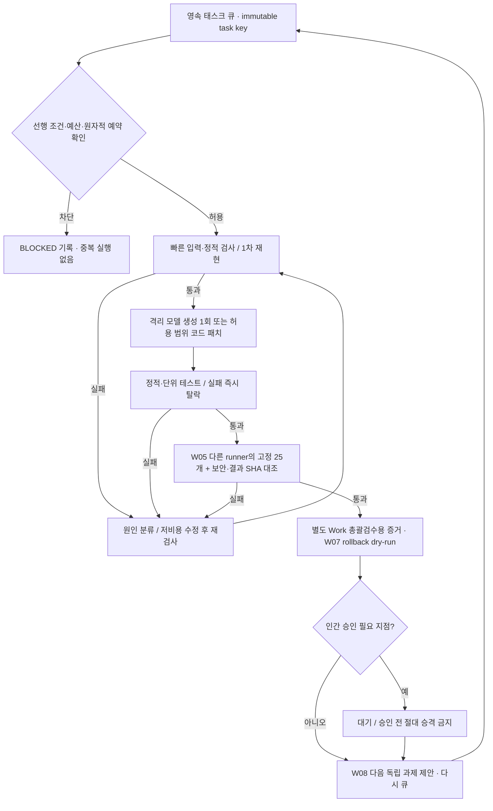

# Hydra × Ouroboros — 최대 처리량 자율 진화 실행 설계 (v0, 2026-11-18)

> **최우선 목표:** 달력 마감일이 아니라 **검증된 개선 한 건의 완료까지 걸리는 시간**과 **시간당 독립 검증을 통과한 개선 건수**를 최적화한다. **현재 문서는 설계안**이며 실행 연결, 모델 코드 성공, CI, 자동 병합을 입증하지 않는다. W01~W08의 고정 25개 검사·별도 W05 독립 재검증·인간 승인 경계는 줄이지 않는다.

## 1. 한 문장 모델

- **Hydra (병렬 탐색):** 서로 충돌하지 않는 태스크를 각기 다른 샌드박스/작업 브랜치에서 실행한다. 무작정 에이전트 수를 늘리지 말고, 임계 경로가 아닌 준비 작업만 선행 병렬화한다.
- **Ouroboros (검증된 개선 축적):** 작업 하나의 실패 → 수정 → 동일 고정 기준 테스트 → 다른 러너 독립 검증 → 결정 → 다음 태스크로 이어지는 단계 전이를 유지한다.
- **독립 총괄검수(사용자의 별도 ChatGPT Work):** 자기평가를 대신하지 않으며 GitHub 원시 아티팩트, 코드·CI SHA, 고정 검사를 근거로만 판정한다. Work 실시간 호출 연결이 없으면 자동으로 실행했다고 주장하지 않는다.

## 2. 속도 우선 DAG

**중요:** `R`의 합격은 모델 코드의 검증이고, `P`의 실제 병합·승격은 별도 사용자 명시 승인 대상이다. 승인 없이 `P`를 건너뛰는 자동 경로를 만들지 않는다. W08 다음 과제 **제안/mock**은 가능하되, W07 미승인 상태의 실행기 활성화나 실제 후속 세대 자동 승격은 차단한다.

## 3. 두 층의 실행 구조

### A. 지금 바로 구현·검증할 수 있는 빠른 경로 (권장 1순위)
1. **한 GitHub Actions 실행 안에서** `preflight → 코드 생성/패치 → 빠른 테스트 → 별도 runner W05 replay → artifact/판정`을 `jobs.needs`로 연결한다. 단계가 끝나면 즉시 다음 단계가 예약되므로 15분 ChatGPT 알림을 기다리지 않는다.
2. 가벼운 검사는 비싼 모델 다운로드/CPU 추론 **이전** 실행한다. 공개 계약의 빈 fixes 요소·12개 상한·UTF-8 128/256 바이트, AST 변경 범위, 서명 아닌 SHA 증거, 저비용 유닛 테스트로 후보를 우선 거른다.
3. W06 실제 새 모델 호출은 W04 작업키/입력/모델 설정/호출 예산이 새롭고 허용될 때만 1회. 이미 실패한 `#44233044418`의 동일 SHA/입력 재호출 금지. 모델 미연결 시 테스트·코드 보완/모의 검증은 가능하지만 모델 자율 개발 진척으로 세지 않는다.
4. 한 번의 workflow 안에서만 두 개 이상의 작업을 연속 처리한다면 각 단계의 체크포인트·원본 응답 SHA·작업별 예산/시간 상한을 고정하고, 하나의 실패가 전체 성공으로 위장하지 않게 한다.
5. 현재 `bounded-qwen-unattended-pilot.yml`의 *단일 실행 내 두 과제+다른 job replay* 패턴을 재사용하되, 과거 실험 성공이 현행 P3L W06 25/25 합격을 뜻하는 것으로 혼동하지 않는다.

### B. 진짜 연속 루프 (2순위, 승인과 별도 배포가 필요)
1. **단일 Coordinator**가 GitHub 이벤트를 검증해 `task_id:contract_sha:base_sha:attempt_id`를 키로 lease를 원자적으로 획득하고, 독립된 새 작업만 시작시킨다. W06·W05는 의존성이 있지만 W03 진단, 연구 fixture, W07 mock 등은 준비 단계에서 병렬화할 수 있다.
2. **영속 큐:** GitHub의 전용 상태 브랜치/외부 동등한 CAS 저장소를 사용한다. `PENDING → LEASED → CODE_READY → VERIFIED / FAILED → REVIEW_PENDING → DONE`과 `BLOCKED`를 명시. 커밋 SHA·세대번호 CAS, lease TTL, 종료·재시작 복구, 완료 중복 처리, 모델 호출 예산 로그 필수. GitHub 이슈 댓글만으로는 분산 잠금이 되지 않는다.
3. **신뢰된 종료 신호:** Actions의 run/job **완료**와 `run_id`, `head_sha`, `artifact SHA`, 결과를 REST 재조회해 매칭한 뒤 다음 `eligible` 작업 하나를 발행한다. 입력 이벤트/PR 설명/모델 출력은 비신뢰 데이터. 불명확한 완료 신호는 BLOCKED/UNVERIFIED로 처리.
4. **GitHub 환경 제약:** 현재 `main`에는 README만 있고 workflow가 없다. GitHub의 `workflow_run`, `workflow_dispatch` 수신 워크플로는 **기본 브랜치에 존재해야 하며**, `workflow_run`의 직접 체인은 최대 3단계다. 따라서 개발 브랜치 Draft PR만으로 무한 이벤트 체인이 작동한다고 주장하지 않는다. 승인된 기본 브랜치 bootstrap **또는** 적법한 별도 상주 오케스트레이터가 필요하다.
5. `concurrency.cancel-in-progress: false`와 현재 지원되는 `queue: max`는 보조 수단일 뿐이다. 해당 기능의 사용 가능 여부·대기열 상한을 실제 워크플로로 확인하고, 별도로 CAS·작업키·idempotency를 유지한다. 단순 동시성 그룹이나 15분 예약은 영속 FIFO/모델 호출 중복 방지의 충분조건이 아니다.
6. 권한 분리: 읽기 전용 모델/시험 실행 job에는 `contents: read`, 자격증명 지속 저장 금지; 쓰기 권한이 필요한 제어 평면은 분리·축소하고 코드/아티팩트 검사 전 권한을 주지 않는다. PR 기반 비신뢰 코드가 높은 권한의 `workflow_run` 경로로 명령을 밀어 넣지 못하도록 설계한다. 자동 main 병합·실행기 승격은 허용하지 않는다.
7. ChatGPT 네 예약(00/15/30/45)은 **현재대로 유지**하되 이벤트 주도 실행이 안전하게 입증되면 감독·비상 복구와 리포트용으로 전환. 네 예약이 직접 서로를 즉시 실행시키는 연결은 없다.

## 4. 실제 최단 경로 — 원인 하나만 먼저 통과

- **현재 병목:** W06 Qwen 7B 1회 실제 모델 호출과 W05 독립 25개 검사(8 ledger + 7 CI + 10 holdout). W06 후보는 실패, 모델이 작성한 새 코드가 **25/25를 통과한 사례는 아직 확인되지 않았다.**
- **먼저:** 공개 계약의 `fixes=[]` 허용 vs `fixes=['']` 거부, 최대 12개, UTF-8 byte 128/256 경계, NUL/LF/ESC, 정확한 검증 소스와 입력 SHA를 짧은 실패 재현 fixture로 고정.
- **다음:** W04 같은 입력/모델/기준 SHA의 1회 호출 예약 게이트 → 승인된 *새* 입력 SHA 한 건으로 W06 CPU 추론 → 정적/단위 → 별도 W05 runner 원본 25개 + SHA 매칭. 원본 고정 25개/비공개 holdout 내용은 수정·모델 프롬프트 노출 금지.
- **그다음:** 후보 합격 시에만 W07 승격 적격·rollback dry-run 및 W08의 서로 다른 다음 과제 *계획/모의 인계* 실증. 승격·병합은 사용자 별도 승인 전 중지.

## 5. 실패·동시성·복구 테스트 (이것 없이는 무인 루프 금지)

| 재현 상황 | 기대 결과 |
|---|---|
| 동일 task_id/SHA로 두 워커 동시 예약 | 오직 한 작업만 lease 성공, 중복 모델 호출 0 |
| 작업 완료·아티팩트 기록 직전에 프로세스 사망 | TTL 후 실행 근거 조회, 완료 재확인, 검증 전 무작정 재호출 금지 |
| 같은 완료 이벤트가 두 번 도착 | 기존 원자적 상태 전이를 재확인, 중복 다음 태스크 0 |
| 이전 branch HEAD가 변경됨 | 기존 후보가 자동 수용되지 않고 차단 |
| 위조된 CI/job 결과·runner ID·SHA | 독립 REST 조회/아티팩트 확인 실패 시 BLOCKED |
| 작은 단위 테스트 실패 | 무거운 재추론/독립 CI 이전 빠른 실패 보고 |
| W05 고정 25개 중 1개 실패 | 후보 REJECTED, W07/W08 진짜 승격 차단 |
| 모델 호출 예산·CPU 시간/용량 초과 | STOP/BLOCKED, 실패 비용·중지 근거 기록 |
| 별도 Work 총괄검수 미연결 | 검수 자료만 기록하고 Work가 승인했다고 주장하지 않음 |
| PR/연구 지시문에 악성 실행 명령 포함 | 비신뢰 데이터 처리, 허용 파일·도구 범위 외 실행 차단 |

## 6. 발전 속도 계측 (날짜 기준 제거)

- **주지표:** `verified_changes_per_hour = 독립 W05 통과 + 실질 코드 변경인 신규 후보 수 / 실제 wall-clock 시간`.
- **기타:** `latency_task_to_replay`, `median_time_to_first_failure`, `model_calls_per_verified_change`, `runner_minutes_per_verified_change`, `duplicate_model_calls`, `rollback_rate`, `independent_replay_mismatch`, 새 과제에서의 실패율.
- **A/B:** 같은 외부 고정 평가 세트·같은 시간/CPU 예산으로 순차 루프와 Hydra 병렬 준비를 비교. 통계적으로 믿을 표본이 쌓이기 전에는 '배속 향상' 주장 금지. 하네스 자체를 수정해도 독립 검증·보안 정책은 수정 대상에서 제외.
- **첫 수용 기준:** 새로운 모델 생성 코드에서 정확히 고정 25/25 + 별도 runner 동일 SHA 합격 증거 1건, 위 실패·중복·권한 반례 통과, 새 과제 mock 인계가 실제 SHA로 추적 가능하고 무승인 승격 0건. 이후 다른 과제에서 반복 재현해야 '자율 진화 가속'을 주장할 수 있다.

## 7. 권장 작업 분담 (시간 슬롯은 스케줄러가 아니라 백업 감독)

- 00분: W06 개발·최초 공개 계약 실패 재현 / 안전한 새 모델 후보
- 15분: W05 별도 runner 검증 및 증거 위조 반례
- 30분: 실패 원인 추적·비용 절감형 다음 수정
- 45분: 새로운 실증만 통합·Work 독립 검수용 자료·다음 적격 태스크 인계
- 모든 예약: 동일 태스크의 최신 HEAD/Actions/원본 SHA를 매회 확인, 중복 댓글/조회 억제, #69의 영속 인계 계약을 존중.

## 8. 구현 순서 (기한 대신 선행조건)

1. **Stage A — Fail-fast DAG:** 개발 브랜치에서 단일 워크플로 내 단계 연결·고정 25개·다른 W05 runner 경로 테스트 및 실패-닫힘 검증. 일부는 현재 코드에 존재하지만 현행 W06 새 합격 증거는 아직 없음.
2. **Stage B — Persistent queue:** 오프라인 CAS·lease·idempotency·TTL/복구 계약, 10개 이상 정·부정 테스트, 실 GitHub API와 격리 비교.
3. **Stage C — Completion-triggered dispatcher:** 별도 승인된 bootstrap 또는 신뢰된 상주 제어기. 이벤트 위조/중복/실패 복구 시험과 소규모 단계적 활성화.
4. **Stage D — Hydra multi-lane + Ouroboros meta-optimizer:** 겹치지 않는 과제만 병렬, 고정 benchmark A/B로 역할·도구·기억 전략을 비교, 이긴 구성도 인간 승인 하에 적용. 자기 평가 기준은 자동 변경 금지.

참조: 공용 작업 인계 #69, 연구 #64, 통합 계획 #37, W05 #41, W06 #43, W06 실제 불합격 #44233044418, 검증기 보완 Draft PR #68/#70. GitHub 공식 문서: https://docs.github.com/en/actions/reference/workflows-and-actions/events-that-trigger-workflows 및 https://docs.github.com/en/actions/reference/workflows-and-actions/workflow-syntax .
